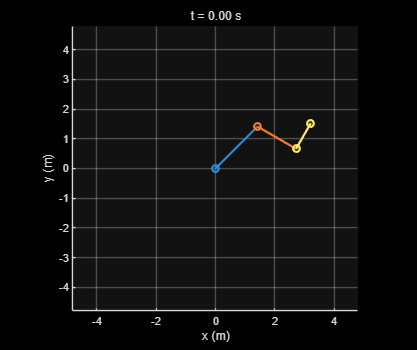
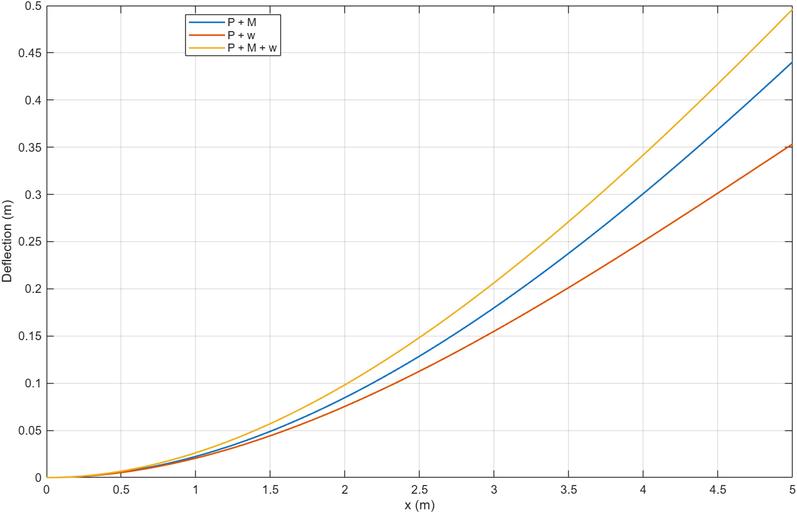
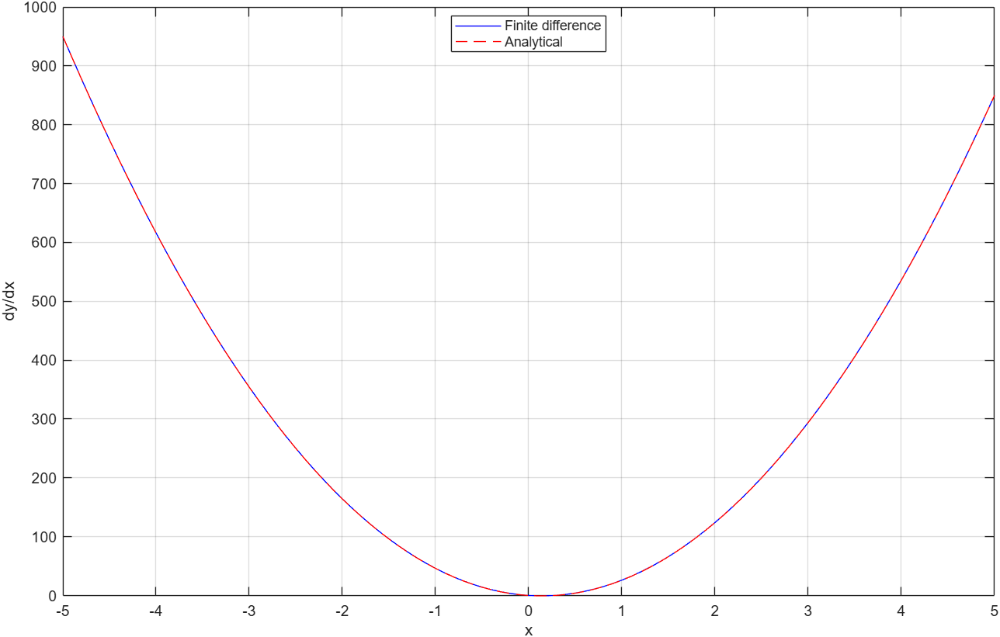
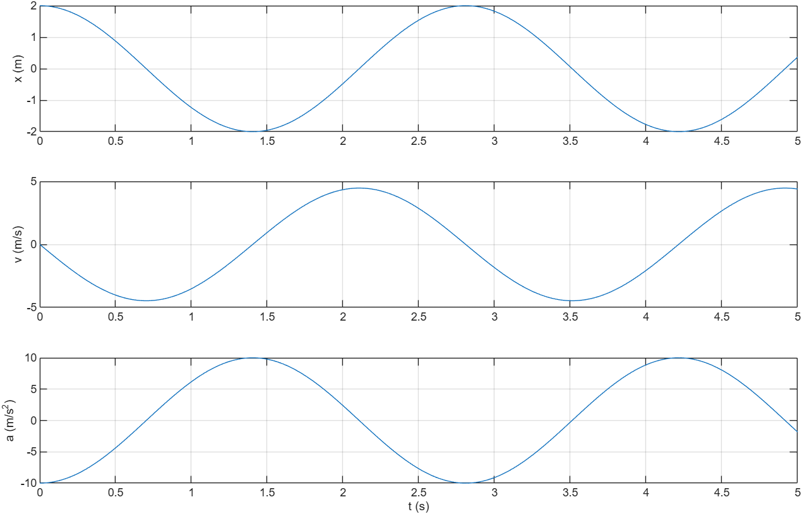

# MATLAB으로 분석한 로봇팔 운동과 공학 수치해석

공학컴퓨터 활용입문의 계산 문제 37개를 MATLAB으로 재구현했습니다. 로봇팔과 외팔보는 움직임과 변형을 시각화하고, 수치미분과 자유진동은 해석해와 비교해 계산 오차를 확인했습니다.

[전체 과제 목록](assignments/README.md) · [검증 방법과 결과](docs/validation.md)

## 대표 문제와 결과

| [3링크 로봇팔의 끝점은 어디를 지날까?](assignments/HW4/problem_01/README.md) | [하중 조합에 따라 외팔보는 얼마나 휠까?](assignments/HW3/problem_03/README.md) |
| --- | --- |
|  |  |
| 각 링크의 끝점을 다음 관절에 연결해 5초 동안 0.01초 간격으로 궤적을 계산했습니다. 회색 선은 로봇팔 끝점이 지나온 경로입니다. | 길이 5 m인 보에 집중하중과 분포하중을 가했을 때 자유단 처짐은 **0.353 m**였습니다. 같은 조건에 모멘트를 더하면 **0.496 m**로 늘었습니다. |

| [격자 간격을 절반으로 줄이면 미분 오차는?](assignments/HW5/problem_02/README.md) | [스프링의 자유진동을 얼마나 정확히 예측할까?](assignments/HW5/problem_05/README.md) |
| --- | --- |
|  |  |
| 다항식의 도함수를 차분으로 근사했습니다. 격자 간격을 0.1에서 0.05로 줄이자 해석해 대비 최대 절대오차가 **0.24에서 0.06**으로 줄었습니다. | 질량 2 kg을 평형점에서 2 m 옮긴 뒤 정지 상태에서 놓는 조건을 모델링했습니다. 5초 동안 `ode45`로 구한 변위와 해석해의 최대 차이는 **1.05 × 10⁻⁹ m**였습니다. |

## 실행

MATLAB에서 저장소 루트를 현재 폴더로 열고 [`run_homework`](run_homework.m)를 실행하면 HW1–HW5의 계산과 검증을 재현할 수 있습니다. 개별 문제는 위 제목에서 풀이와 코드를 확인한 뒤 해당 폴더에서 `main`으로 실행합니다.
