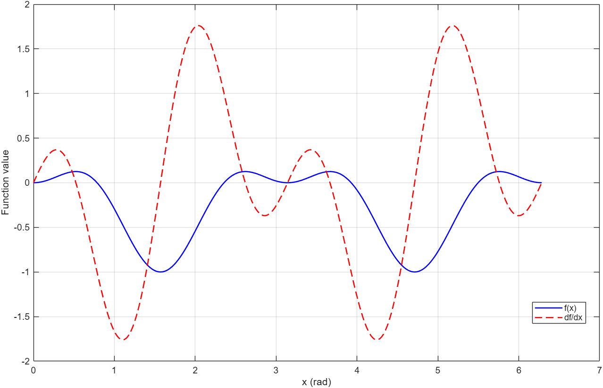

# HW2 · 문제 10: 함수와 도함수 비교 그래프

## 문제

0≤x≤2π에서 f(x)=sin²(x)cos(2x)와 x에 대한 도함수를 하나의 plot에 표시하고 label과 legend를 추가한다.

[원본 PDF 2쪽](../../EngComp_HW2.pdf#page=2)

## 풀이

곱·연쇄법칙으로 f′(x)=2sin(x)cos(x)cos(2x)−2sin²(x)sin(2x)이다. 함수의 배열 계산에는 `.*`, `.^`를 사용한다. 내부 구간의 중앙차분과 해석 도함수를 비교한다.

## 실행과 결과

이 폴더에서 `main`을 실행합니다. 계산값은 `results`에 저장되고 검증 실패 시 `assert`가 오류를 발생시킵니다. 상위 폴더에서 `run_all`을 실행하면 결과 파일과 그래프가 갱신됩니다.

[MATLAB 코드](main.m) · [실행 결과](results.txt) · [HW2 목록](../README.md)

