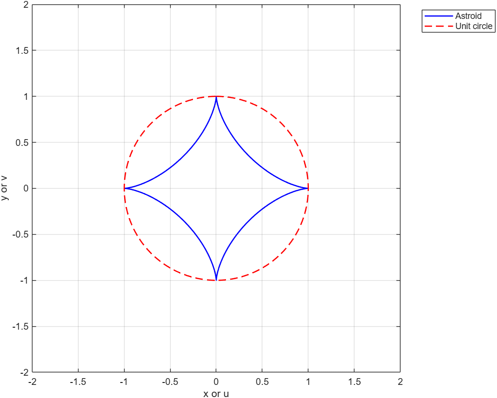

# HW2 · 문제 11: 매개변수 곡선 두 개

## 요구사항

0≤t≤2π에서 x=cos³t, y=sin³t와 u=sint, v=cost를 같은 plot에 그리고 양 축 범위를 [−2,2]로 제한한다.

## 해결 방법

첫 곡선은 아스트로이드, 두 번째는 단위원이다. 두 축의 축척이 동일하도록 axis equal을 적용한 뒤 axis([-2 2 -2 2])로 범위를 설정한다.

## 결과

아스트로이드와 단위원을 같은 축에 표시했다. 두 곡선의 항등식 최대 오차는 각각 약 **2.22×10⁻¹⁶**이었다.

[MATLAB 코드](main.m) · [실행 결과](results.txt) · [HW2 목록](../README.md)

## 실행 방법

이 폴더에서 MATLAB의 `main`을 실행한다. 과제 전체 실행은 상위 폴더의 `run_all`을 사용한다.
