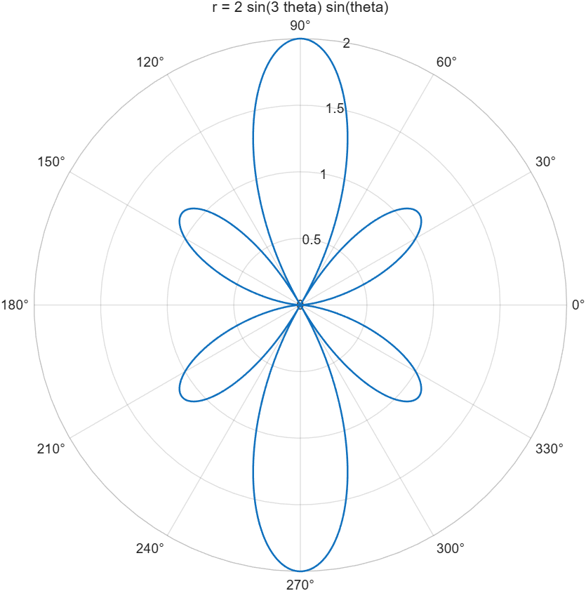

# HW2 · 문제 12: 극좌표 함수

## 요구사항

r=2sin(3θ)sinθ, 0≤θ≤2π를 polarplot으로 그린다.

[원본 PDF 2쪽](../../EngComp_HW2.pdf#page=2)

## 해결 방법

각도 배열은 라디안이며 두 사인 배열의 곱은 `.*`이다. 음수 반지름도 원래 함수값 그대로 polarplot에 전달한다.

## 결과

표본 반경은 약 **−2~1.124997** 범위였고, θ=π/2에서 **r=−2**였다.

[MATLAB 코드](main.m) · [실행 결과](results.txt) · [HW2 목록](../README.md)

## 실행 방법

이 폴더에서 MATLAB의 `main`을 실행한다. 과제 전체 실행은 상위 폴더의 `run_all`을 사용한다.
