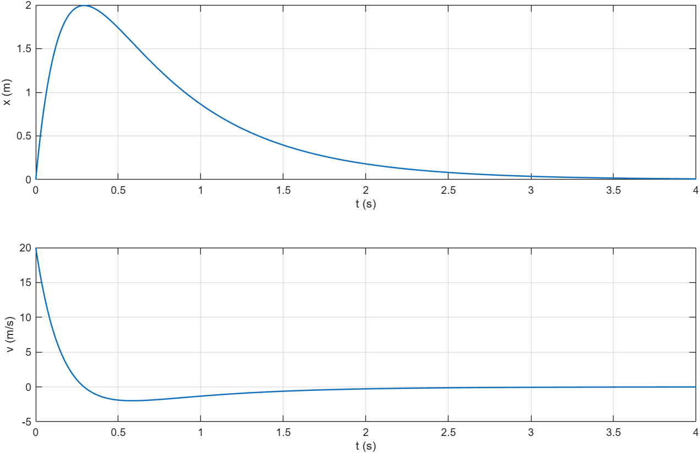

# HW2 · 문제 13: 철도 완충장치 변위와 속도

## 문제

질량 20,000 kg, 초기 속도 20 m/s인 차량의 응답이 x(t)=4.219(e^(−1.58t)−e^(−6.32t)), v(t)=26.67e^(−6.32t)−6.67e^(−1.58t)이다. 0≤t≤4 s에서 변위와 속도를 subplot으로 그린다.

[원본 PDF 2쪽](../../EngComp_HW2.pdf#page=2)

## 풀이

주어진 지수함수 응답을 그대로 계산한다. 원문의 계수가 반올림되어 x의 미분 계수(26.66408, 6.66602)와 v의 인쇄 계수(26.67, 6.67)가 조금 다르다. 이 차이는 별도로 기록하고 초기 변위 0, 초기 속도 20을 확인한다.

## 실행과 결과

이 폴더에서 `main`을 실행합니다. 계산값은 `results`에 저장되고 검증 실패 시 `assert`가 오류를 발생시킵니다. 상위 폴더에서 `run_all`을 실행하면 결과 파일과 그래프가 갱신됩니다.

[MATLAB 코드](main.m) · [실행 결과](results.txt) · [HW2 목록](../README.md)

