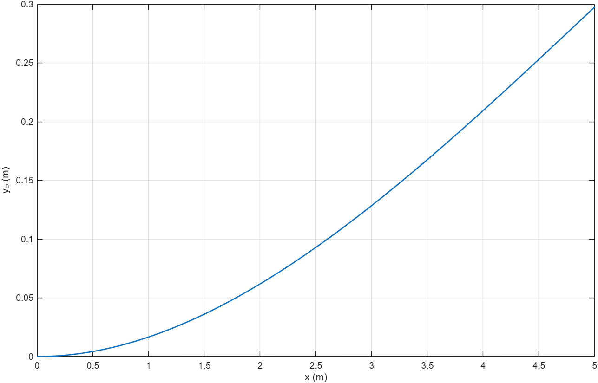

# HW3 · 문제 01: 집중하중에 의한 외팔보 처짐

## 요구사항

E=70 GPa, I=10⁻⁴ m⁴, L=5 m, P=50 kN인 외팔보에서 yP(x)=Px²(3L−x)/(6EI)를 계산하는 Defl_P 함수를 구현하고 x∈[0,5] m의 처짐을 그린다.

## 해결 방법

모든 값을 SI 단위로 통일한다. x가 배열이므로 x의 제곱과 다항식의 곱에 요소별 연산을 사용한다. 고정단 처짐은 0, 자유단 처짐은 PL³/(3EI)이다. 원문 처짐 식의 부호 규약을 따른다.

## 결과

고정단 처짐은 **0 m**, 자유단 처짐은 **0.297619 m**로 해석식과 일치했다.

[실행 코드](main.m) · [계산 결과](results.txt) · [과제 목록](../README.md)

[처짐 함수](Defl_P.m)

## 실행 방법

이 폴더에서 MATLAB의 `main`을 실행한다. 과제 전체 실행은 상위 폴더의 `run_all`을 사용한다.
