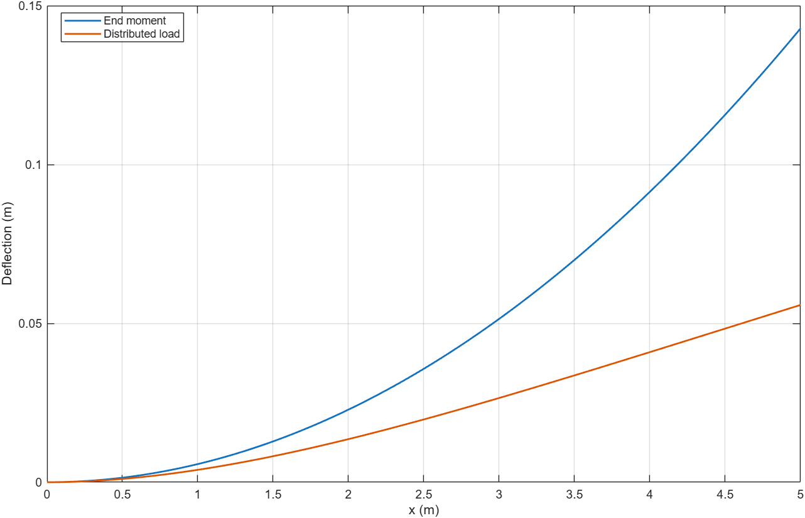

# HW3 · 문제 02: 모멘트와 등분포하중 처짐

## 요구사항

동일한 보 E=70 GPa, I=10⁻⁴ m⁴, L=5 m에 M=8×10⁴ N·m 또는 w=5×10³ N/m를 각각 적용한다. yM=Mx²/(2EI), yw=wx²(x²+6L²−4Lx)/(24EI)를 함수로 구현하고 비교한다. 모멘트는 반시계방향이 +이다.

## 해결 방법

두 하중이 각각 작용할 때의 처짐을 같은 축에 그린다. 자유단에서 yM=ML²/(2EI), yw=wL⁴/(8EI)인지 확인한다.

## 결과

자유단 처짐은 모멘트 하중에서 **0.142857 m**, 등분포하중에서 **0.055804 m**였다.

[실행 코드](main.m) · [계산 결과](results.txt) · [과제 목록](../README.md)

[Defl_M](Defl_M.m) · [Defl_w](Defl_w.m)

## 실행 방법

이 폴더에서 MATLAB의 `main`을 실행한다. 과제 전체 실행은 상위 폴더의 `run_all`을 사용한다.
