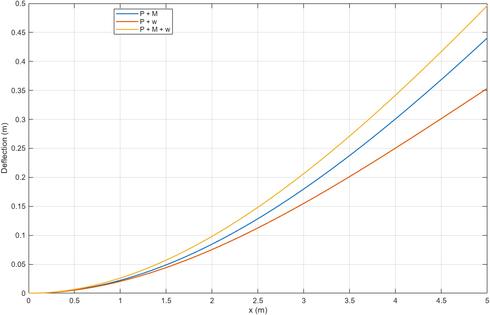

# HW3 · 문제 03: 복합하중 처짐의 중첩

## 문제

Defl_tot 함수의 인자로 하중 종류를 선택할 수 있게 하고, 세 종류 이상의 하중 조합에 대한 전체 처짐을 비교한다. 전체 처짐은 yP+yM+yw이다.

[원본 PDF 4쪽](../../HW3.pdf#page=4)

## 풀이

함수의 loads 구조체에 P, M, w 중 필요한 항목을 넣는다. 없는 항목은 0으로 취급한다. 세 조합 P+M, P+w, P+M+w를 비교하며 각 하중의 값은 문제 1·2를 따른다. 이는 선형 탄성 보의 중첩이며 별도 유한요소해석은 아니다.

## 실행과 결과

이 폴더를 MATLAB 현재 폴더로 선택한 뒤 `main`을 실행합니다. 상위 폴더의 `run_all`은 전체 문제를 실행하고 결과 텍스트와 그래프를 저장합니다.

[실행 코드](main.m) · [계산 결과](results.txt) · [과제 목록](../README.md)

[복합하중 함수](Defl_tot.m)
