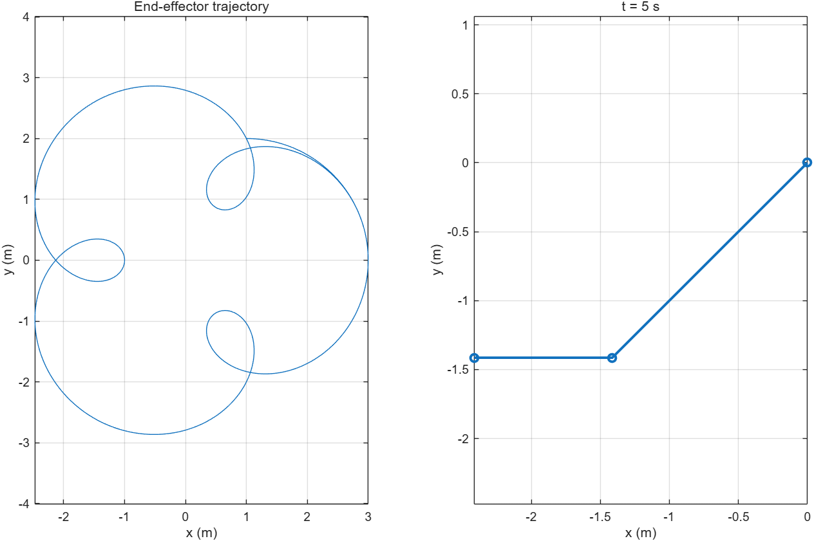

# HW3 · 문제 04: 2링크 로봇팔 궤적과 자세

## 문제

L1=2 m, L2=1 m, 0≤t≤10 s, θ1=πt/4, θ2=πt(0≤t≤8), θ2=8π(8<t≤10)이다. 관절 A=[L1cosθ1,L1sinθ1], 끝점 r=A+[L2cosθ2,L2sinθ2]의 궤적과 t=5 s 자세를 그린다.

[원본 PDF 5쪽](../../HW3.pdf#page=5)

## 풀이

원문의 θ1, θ2는 모두 고정 x축 기준 절대각이다. 따라서 θ1+θ2로 합하지 않는다. dt=0.01 s로 계산하고, t=5 s에 A=[−√2,−√2], 끝점=[−√2−1,−√2]인지 확인한다. GIF는 원문의 부록 예제를 적용한 보조 시각화로 0.1 s 간격 101프레임을 저장한다.

## 실행과 결과

이 폴더를 MATLAB 현재 폴더로 선택한 뒤 `main`을 실행합니다. 상위 폴더의 `run_all`은 전체 문제를 실행하고 결과 텍스트와 그래프를 저장합니다.

[실행 코드](main.m) · [계산 결과](results.txt) · [과제 목록](../README.md)

[애니메이션 코드](save_animation.m) · [GIF 결과](Result.gif)
