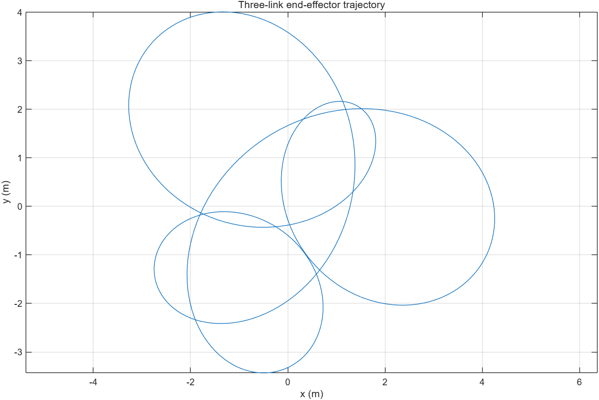

# HW4 · 문제 01: n-Link 클래스와 3링크 애니메이션

## 문제

Link 클래스에 length, th_0, th, joint_pos, 종속 속성 end_pos와 생성자·각도/관절 위치 업데이트·시각화 메서드를 구현한다. Cell 배열로 링크를 저장하고 3링크 길이 [2,1.5,1] m, 초기각 [π/4,−π/6,π/3], 각속도 [2π,−0.5π,π] rad/s, t=0:0.01:5 s에서 시뮬레이션한다. 첫 관절은 [0,0]이다. 제출 요소는 Link.m, main.m, Result.gif이다.

[원본 PDF 2쪽](../../HW4.pdf#page=2)

## 풀이

원문은 하나의 통합 과제이므로 임의로 여러 번호를 붙이지 않고 `problem_01`에 전체 구현을 모았다. 각 링크의 각도는 고정 좌표계에 대한 절대각이다. 앞 링크의 끝점을 다음 링크의 시작점으로 갱신한다. 객체 상태 변경을 유지하기 위해 handle 클래스를 사용한다. 수치 계산은 501시점 전체를 수행하며 GIF는 5시점마다 한 프레임(0.05 s, 총 101프레임)을 저장한다. 각 링크 길이 불변성과 초기·최종 끝점 위치를 검증한다.

GIF 작성 함수도 위치 배열에서 링크 수를 읽고, 링크 길이 합에 맞춰 축 범위를 정합니다. 링크 수를 바꿀 때에는 `lengths`, `init_angles`, `rates`의 원소 수를 함께 맞춥니다. 원문 제출 조건은 위의 3링크이며, 1·4링크는 함수의 일반성을 확인하는 추가 시험입니다.

## 실행과 결과

이 폴더를 MATLAB 현재 폴더로 선택한 뒤 `main`을 실행합니다. 상위 폴더의 `run_all`은 전체 문제를 실행하고 결과 텍스트와 그래프를 저장합니다.

[실행 코드](main.m) · [계산 결과](results.txt) · [과제 목록](../README.md)

[Link 클래스](Link.m) · [GIF 결과](Result.gif) · [끝점 궤적 CSV](trajectory.csv) · [GIF 작성 함수](save_animation.m)
