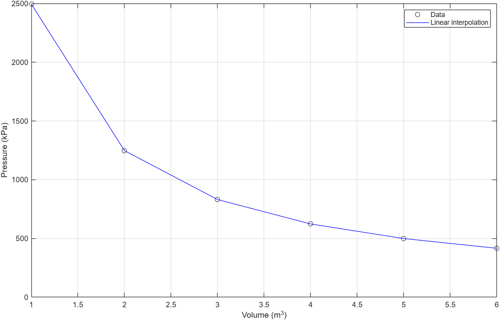

# HW5 · 문제 01: 압력·부피 데이터 보간

## 요구사항

V=[1,2,3,4,5,6] m³, P=[2494,1247,831,623,499,416] kPa이다. (a,b) V=3.8의 압력을 linear와 spline으로 각각 추정한다. (c,d) P=1000 kPa의 부피를 linear와 spline으로 각각 추정한다. (e) V를 0.2 m³ 간격으로 세분화한 선형 보간 표를 출력한다.

[원본 PDF 1쪽](../../HW5.pdf#page=1)

## 해결 방법

`interp1(V,P,3.8,method)`로 압력을, 압력 데이터를 오름차순으로 정렬한 뒤 `interp1(P,V,1000,method)`로 부피를 추정한다. 이는 역방향 데이터의 스플라인 보간이며 순방향 스플라인의 근을 구하는 방법과는 다르다. 원문 일부에서 부피 단위를 m²로 썼지만 표와 (e)의 m³를 기준으로 정리했다. 보간은 관측 범위 안에서만 한다.

## 결과

V=3.8 m³의 압력은 선형 **664.6 kPa**, 스플라인 **657.4373 kPa**였다. P=1000 kPa의 부피는 각각 **2.593750 m³, 2.477860 m³**였다.

[실행 코드](main.m) · [계산 결과](results.txt) · [과제 목록](../README.md)

[0.2 m³ 간격 보간 표](interpolation.csv)

## 실행 방법

이 폴더에서 MATLAB의 `main`을 실행한다. 과제 전체 실행은 상위 폴더의 `run_all`을 사용한다.
