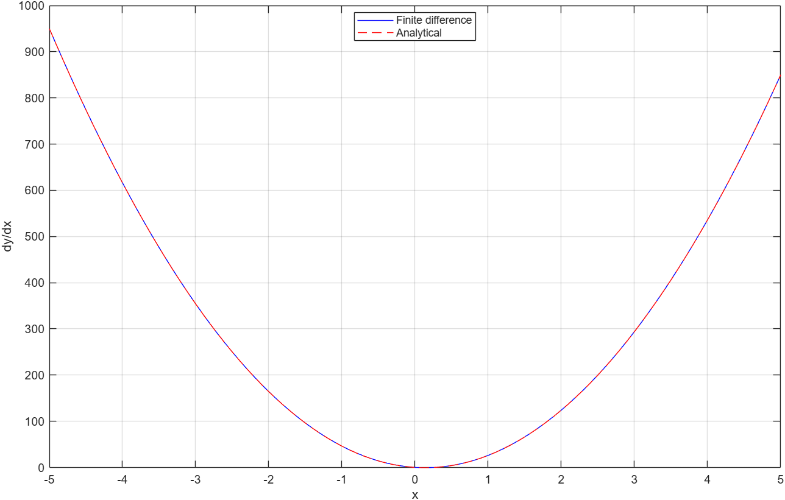

# HW5 · 문제 02: 다항함수의 수치미분

## 요구사항

x=−5:0.1:5에서 y=12x³−5x²+3을 임의의 수치미분 기법으로 미분하고 도함수를 x에 대해 그린다.

## 해결 방법

내부 점은 중앙차분, 양 끝은 2차 정확도 단측차분을 사용한다. 해석 도함수는 36x²−10x이며 검증용으로만 함께 표시한다. 세제곱 다항식의 중앙차분 오차는 12h²=0.12이고 양 끝의 오차 절댓값은 24h²=0.24이다. 간격을 절반으로 줄였을 때 최대 오차가 약 1/4이 되는지도 확인한다.

## 결과

h=0.1에서 최대 절대오차는 **0.24**, 내부 점에서는 **0.12**였다. h=0.05에서는 최대오차가 **0.06**으로 줄어 2차 수렴을 확인했다.

[실행 코드](main.m) · [계산 결과](results.txt) · [과제 목록](../README.md)

## 실행 방법

이 폴더에서 MATLAB의 `main`을 실행한다. 과제 전체 실행은 상위 폴더의 `run_all`을 사용한다.
