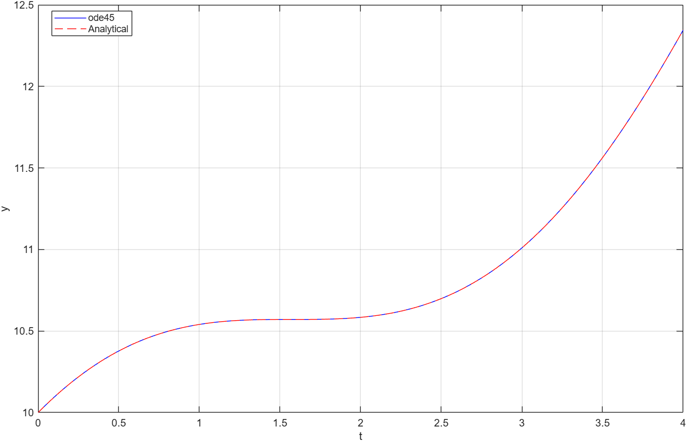

# HW5 · 문제 04: 1차 미분방정식의 ode45 해

## 문제

dy/dt+sin(t)=1, y(0)=10을 ode45로 풀고 0≤t≤4에서 y(t)를 그린다.

[원본 PDF 1쪽](../../HW5.pdf#page=1)

## 풀이

도함수 형태 y′=1−sin(t)로 옮긴다. 해석해 y=t+cos(t)+9와 비교한다. ode45의 RelTol=10⁻⁹, AbsTol=10⁻¹¹을 지정해 기본 허용오차에 따른 실행 차이를 줄인다.

## 실행과 결과

이 폴더를 MATLAB 현재 폴더로 선택한 뒤 `main`을 실행합니다. 상위 폴더의 `run_all`은 전체 문제를 실행하고 결과 텍스트와 그래프를 저장합니다.

[실행 코드](main.m) · [계산 결과](results.txt) · [과제 목록](../README.md)

