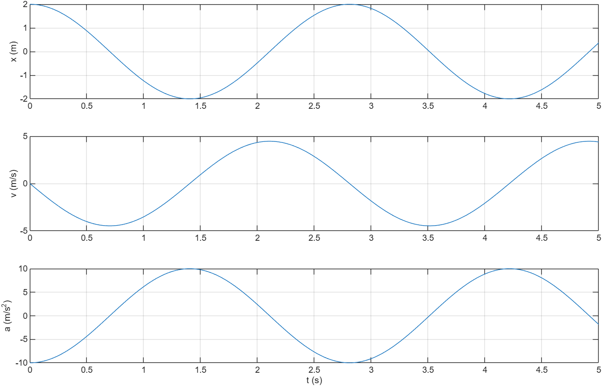

# HW5 · 문제 05: 질량–스프링 자유진동

## 문제

k=10 N/m, m=2 kg, 초기 변위 x(0)=2 m인 1자유도 spring-mass 시스템을 ode45로 풀고 t∈[0,5] s에서 변위·속도·가속도를 subplot에 각각 그린다. 원문에는 초기 속도가 명시되지 않았다.

[원본 PDF 1쪽](../../HW5.pdf#page=1)

## 풀이

초기 속도는 **v(0)=0 m/s(정지 상태에서 놓음)**으로 가정한다. 이를 숨기지 않고 코드 입력 변수로 둔다. 상태 z=[x;v]로 정의하면 z′=[v;−kx/m]이다. 가속도는 수치 재미분 대신 −kx/m로 계산한다. ω=sqrt(k/m)의 해석해 x=x0cosωt+(v0/ω)sinωt와 에너지 보존을 확인한다.

## 실행과 결과

이 폴더를 MATLAB 현재 폴더로 선택한 뒤 `main`을 실행합니다. 상위 폴더의 `run_all`은 전체 문제를 실행하고 결과 텍스트와 그래프를 저장합니다.

[실행 코드](main.m) · [계산 결과](results.txt) · [과제 목록](../README.md)

